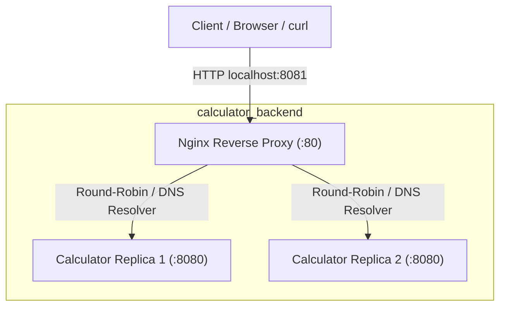
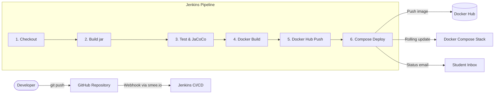

# Calculator REST API & DevOps Pipeline

End-to-end CI/CD pipeline for a Spring Boot Calculator REST API: Git/GitHub → Jenkins → Docker → Docker Compose.


---

## 1. Overview

The Calculator API is a production-grade microservice implemented in Java 17 and Spring Boot 3. It exposes standard arithmetic operations (`add`, `subtract`, `multiply`, `divide`) with exact decimal precision, input validation, structured HTTP 400 error payloads, and Spring Boot Actuator health checks.

---

## 2. Tech Stack

- **Language:** Java 17
- **Framework:** Spring Boot 3.4.2 (Spring Web, Spring Boot Actuator)
- **Build & Dependency Management:** Apache Maven with Maven Wrapper (`./mvnw`)
- **Testing:** JUnit 5, AssertJ, Spring MockMvc
- **Code Coverage:** JaCoCo (80% line coverage gate)

---

## 3. API Reference

All calculator endpoints are rooted at `/api/v1` and accept query parameters `a` and `b`.

| Operation | Method | Endpoint | Query Params | Description |
|---|---|---|---|---|
| **Add** | `GET` | `/api/v1/add` | `a`, `b` | Returns `a + b` |
| **Subtract** | `GET` | `/api/v1/subtract` | `a`, `b` | Returns `a - b` |
| **Multiply** | `GET` | `/api/v1/multiply` | `a`, `b` | Returns `a * b` |
| **Divide** | `GET` | `/api/v1/divide` | `a`, `b` | Returns `a / b` (HTTP 400 on `b=0`) |
| **Health** | `GET` | `/actuator/health` | None | Spring Boot Actuator health probe |
| **Info** | `GET` | `/actuator/info` | None | Application metadata & version |

### Example Requests & Responses

#### 1. Addition
```bash
curl -s "http://localhost:8080/api/v1/add?a=2&b=3"
```
**Response (HTTP 200):**
```json
{
  "operation": "add",
  "a": 2,
  "b": 3,
  "result": 5
}
```

#### 2. Division (Decimal Precision)
```bash
curl -s "http://localhost:8080/api/v1/divide?a=10&b=4"
```
**Response (HTTP 200):**
```json
{
  "operation": "divide",
  "a": 10,
  "b": 4,
  "result": 2.5
}
```

#### 3. Division by Zero (Validation Error)
```bash
curl -s -i "http://localhost:8080/api/v1/divide?a=10&b=0"
```
**Response (HTTP 400 Bad Request):**
```json
{
  "timestamp": "2026-10-27T11:00:00Z",
  "status": 400,
  "error": "Bad Request",
  "message": "Division by zero is not allowed",
  "path": "/api/v1/divide"
}
```

#### 4. Missing Parameter
```bash
curl -s -i "http://localhost:8080/api/v1/add?a=1"
```
**Response (HTTP 400 Bad Request):**
```json
{
  "timestamp": "2026-10-27T11:00:00Z",
  "status": 400,
  "error": "Bad Request",
  "message": "Missing required parameter 'b'",
  "path": "/api/v1/add"
}
```

#### 5. Health Check
```bash
curl -s "http://localhost:8080/actuator/health"
```
**Response (HTTP 200):**
```json
{
  "status": "UP"
}
```

---

## 4. Build, Test, and Run Locally

### Prerequisites
- JDK 17 or higher
- Git

### Commands

1. **Compile and run tests:**
   ```bash
   ./mvnw clean test
   ```
   Surefire reports are written to `target/surefire-reports/`, and the JaCoCo coverage report is generated at `target/site/jacoco/index.html`.

2. **Package the executable JAR:**
   ```bash
   ./mvnw clean package
   ```
   Produces `target/calculator-api.jar`.

3. **Run the application:**
   ```bash
   ./mvnw spring-boot:run
   # or
   java -jar target/calculator-api.jar
   ```

---

## 5. Run with Docker

The application includes a production-ready, multi-stage `Dockerfile`.

### Build the Image
```bash
docker build -t calculator-api:local .
```

### Run the Container
Run the container on port 9090 with a single command:
```bash
docker run --rm -d --name calc-test -p 9090:8080 calculator-api:local
```

### Verify Endpoints
```bash
# Verify arithmetic
curl -s "http://localhost:9090/api/v1/add?a=2&b=3"

# Verify health status
curl -s "http://localhost:9090/actuator/health"

# Verify container user (non-root)
docker exec calc-test whoami
# Output: app

# Stop the container
docker stop calc-test
```

### Docker Best Practices Applied
- **Multi-Stage Build:** Stage 1 (`maven:3.9-eclipse-temurin-17`) compiles and packages the artifact; stage 2 (`eclipse-temurin:17-jre-jammy`) packages only the executable JAR.
- **Dependency Layer Caching:** `pom.xml` is copied and dependencies resolved via `mvn dependency:go-offline` before copying application source code, avoiding re-downloading dependencies on every code change.
- **Minimal Runtime Image:** JRE-only base with no compiler or build tools.
- **Non-Root Execution:** Runs under dedicated unprivileged system user `app` (UID 1001).
- **Explicit EXPOSE:** Clearly documents port `8080`.
- **Built-in Healthcheck:** Integrated Docker `HEALTHCHECK` querying `/actuator/health`.
- **Build Context Optimization:** `.dockerignore` excludes git history, IDE settings, and build artifacts.

---

## 6. Deploy with Docker Compose

A multi-container stack orchestrated via Docker Compose, running **two replicas** of the Calculator service behind an **Nginx reverse proxy and load balancer**.

### Architecture



### Services Description
- **`calculator`**: Runs the Spring Boot API in 2 replicas (`deploy.replicas: 2`). Memory limit is set to 512MB each (`-XX:MaxRAMPercentage=75.0`). Connected to the private `backend` bridge network with no exposed host ports. Healthcheck polls `/actuator/health`.
- **`nginx`**: Custom Nginx reverse proxy image (`nginx/Dockerfile`) listening on host port `8081` (configurable via `${HOST_PORT}`). Waits for backend service health (`condition: service_healthy`) before accepting traffic. Employs Docker embedded DNS (`127.0.0.11 valid=5s`) to dynamically resolve redeployed replica IPs.

### One-Command Deployment
```bash
docker compose up -d --build --wait
```

### Verification
1. **API Calculation via Proxy:**
   ```bash
   curl -s "http://localhost:8081/api/v1/add?a=2&b=3"
   # {"operation":"add","a":2,"b":3,"result":5}
   ```

2. **Application Info & Injected Version:**
   ```bash
   curl -s "http://localhost:8081/actuator/info"
   # {"app":{"name":"calculator-api","version":"dev"}}
   ```

3. **Verify Load Balancing (X-Upstream header):**
   ```bash
   for i in 1 2 3 4 5 6; do curl -sI "http://localhost:8081/actuator/health" | grep -i x-upstream; done
   # Output alternates between replica internal IPs (e.g., 172.19.0.2:8080 and 172.19.0.3:8080)
   ```

4. **Self-Healing Verification:**
   ```bash
   # Kill one replica
   docker kill $(docker compose ps -q calculator | head -1)
   
   # Service remains available seamlessly through the second replica
   curl -s "http://localhost:8081/actuator/health"
   
   # Restart policy automatically recovers the replica
   docker compose ps
   ```

### Overriding Image Tag
```bash
IMAGE_TAG=1.0.0 docker compose up -d
```

### Stopping the Stack
```bash
docker compose down
```

---

## 7. CI/CD Pipeline (Jenkins)

The repository implements a fully automated declarative Jenkins pipeline (`Jenkinsfile`) following modern DevSecOps practices.

### Pipeline Workflow



### Pipeline Stages

| Stage | Command / Action | Purpose | On Failure |
|---|---|---|---|
| **Checkout** | `checkout scm` | Pulls branch commit and logs short hash/author | Pipeline aborts |
| **Build** | `mvn -B clean package -DskipTests` | Compiles application and packages executable JAR artifact | Pipeline aborts, no artifact archived |
| **Test** | `mvn -B test` | Executes 34 unit & MockMvc integration tests; enforces 80% JaCoCo coverage | Fails stage, archives JUnit XML & JaCoCo HTML; sends failure email; aborts deployment |
| **Docker Build** | `docker build --pull -t $IMAGE_NAME:$IMAGE_TAG -t $IMAGE_NAME:latest .` | Multi-stage image build tagged with Jenkins `${BUILD_NUMBER}` and `latest` | Aborts pipeline |
| **Push** | `docker push` with `withCredentials` | Authenticates to Docker Hub using Jenkins Credential Store (`dockerhub-creds`) | Aborts pipeline; tokens masked in console |
| **Deploy** | `docker compose pull && docker compose up -d --build --wait` | Idempotent deployment of 2 replicas + Nginx; verifies internal proxy health probes | Dumps compose logs; sends failure email; existing good deployment remains untouched |

### Running Jenkins Locally as Code

Jenkins itself is containerized with Docker CLI, Compose v2 plugin, and Maven pre-installed:

```bash
cd jenkins
docker compose up -d --build
```
- **Access UI:** `http://localhost:8080`
- **Initial Admin Password:**
  ```bash
  docker compose exec jenkins cat /var/jenkins_home/secrets/initialAdminPassword
  ```

### Credentials & Security Management
- All sensitive tokens (Docker Hub access token, email passwords) are stored exclusively inside the **Jenkins Credentials Store** (`dockerhub-creds`).
- No secrets, tokens, or private credentials are ever stored in source code, configuration files, or git history.

---

## 8. Project Structure

```text
.
├── .github/
│   └── pull_request_template.md
├── docs/
│   └── SPE_Mini_Project.docx
├── jenkins/
│   ├── Dockerfile
│   └── docker-compose.yml
├── nginx/
│   ├── default.conf
│   └── Dockerfile
├── src/
│   ├── main/
│   │   ├── java/com/vaishak/calculator/
│   │   │   ├── CalculatorApplication.java
│   │   │   ├── controller/
│   │   │   │   └── CalculatorController.java
│   │   │   ├── dto/
│   │   │   │   ├── CalculationResponse.java
│   │   │   │   └── ErrorResponse.java
│   │   │   ├── exception/
│   │   │   │   ├── DivisionByZeroException.java
│   │   │   │   └── GlobalExceptionHandler.java
│   │   │   └── service/
│   │   │       └── CalculatorService.java
│   │   └── resources/
│   │       └── application.yml
│   └── test/
│       └── java/com/vaishak/calculator/
│           ├── controller/
│           │   └── CalculatorControllerTest.java
│           └── service/
│               └── CalculatorServiceTest.java
├── .dockerignore
├── .gitattributes
├── .gitignore
├── docker-compose.yml
├── Dockerfile
├── Jenkinsfile
├── LICENSE
├── mvnw
├── mvnw.cmd
├── pom.xml
└── README.md
```


